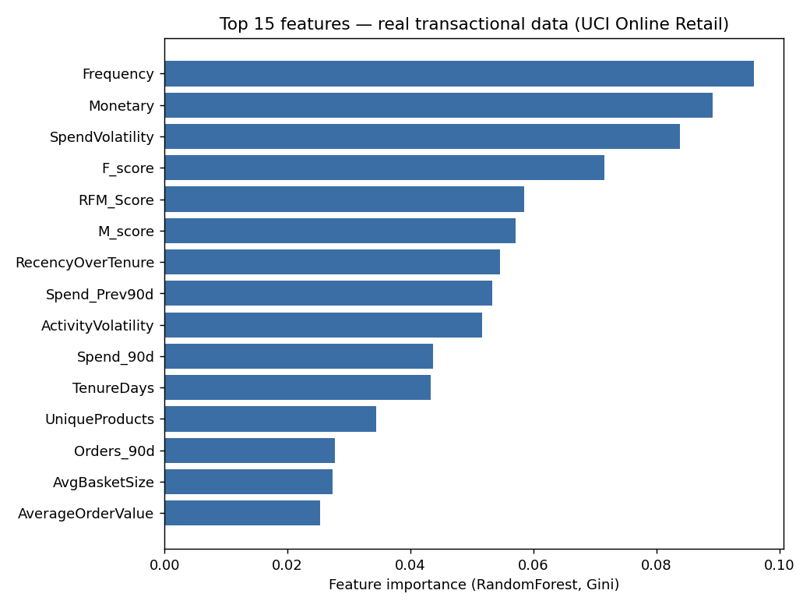

# CuStorA External Validation: Real-World Temporal Churn (UCI Online Retail)

**Dataset source:** Daqing Chen, Sai Liang Sain, Kun Guo, *"Data mining for
the online retail industry: A case study of RFM model-based customer
segmentation using data mining"*, Journal of Database Marketing and
Customer Strategy Management, Vol. 19, No. 3, 2012.
https://archive.ics.uci.edu/dataset/352/online+retail — pulled (already
cleaned of cancellations/adjustments and rows with missing CustomerID by
a third party, row counts cross-checked against the dataset's known
public statistics) from
`raw.githubusercontent.com/eaintkyawthmu/UCI_Online_Retail_Dataset_Cleaned_Version`
and stored unmodified at `data/external/online_retail_transactions_uci.csv`.

**What this is:** 530,103 real, individual purchase-line transactions
from **4,340 real customers** of a UK-based online gift retailer, spanning
**Dec 1, 2010 – Dec 9, 2011** (13 months). Every row has a real invoice
number, a real `InvoiceDate`, a real `CustomerID`, and a real revenue
amount (`Quantity x UnitPrice`).

## Why this validation is different from the other two

`reports/external_validation/` (Telco) and
`reports/external_validation_ecommerce/` (Kaggle E-Commerce Churn) are
both **snapshot** datasets — one row per customer, a handful of
already-aggregated features, and a pre-computed churn label. That's
useful for testing whether CuStorA's modeling *methodology* finds
genuine signal on data it had no hand in generating, but it structurally
cannot support two things a real churn system needs:

1. **A defensible churn label.** "Churn = 1" in a snapshot dataset means
   whatever the original dataset authors decided it means. It is not
   possible to ask "given what we knew on a specific date, did this
   customer actually stop buying afterward?"
2. **Temporal features.** Recency *trends*, frequency *changes*,
   activity *slopes* and *volatility* all require a transaction ledger
   with real dates, not a single all-time snapshot.

This dataset has a real per-invoice ledger, so both of those become
possible. This is the validation that actually exercises the roadmap's
Tier-1 priorities (see `reports/accuracy_improvement_log.md` context):
real data, a proper forward-looking observation-window label, temporal
trend/slope/volatility features, and a time-based (not random)
train/validation/test split.

## 1. Methodology

Built by `scripts/build_temporal_snapshots_online_retail.py` and
`scripts/run_temporal_validation_online_retail.py`.

**Churn label.** For each of 6 monthly cutoff dates (2011-03-31 through
2011-08-31), a customer is included only if they made a purchase in the
60 days *before* the cutoff (i.e. they were an active customer, not
someone who had already left long ago or a brand-new signup with no
history to learn from). `Churn = 1` if that customer makes **zero**
purchases in the **90 days after** the cutoff, else `0`. This produces
**9,156 (customer, cutoff-date) snapshot rows** — the same customer
appears multiple times across different cutoffs, as a different
"as-of" prediction problem each time (roadmap item #15).

**Features (30 total, all computed using only transactions with
`InvoiceDate <= cutoff_date` — see the module docstring in
`build_temporal_snapshots_online_retail.py` for the exact leakage-safe
windowing logic):**

| Group | Features |
|---|---|
| RFM | Recency, Frequency, Monetary, AverageOrderValue, R/F/M quintile scores, RFM_Score |
| Trend | Orders/Spend in last 30d vs. prior 30d, last 90d vs. prior 90d, FreqTrendRatio, SpendTrendRatio, SpendChange30d, FreqChange90d |
| Slope / volatility | ActivitySlope, ActivityVolatility, SpendSlope, SpendVolatility (12-week trailing OLS slope and coefficient of variation of weekly order/spend counts) |
| Lifecycle | TenureDays, UniqueProducts, AvgBasketSize |
| Interaction | RecencyXMonetary, RecencyOverTenure |
| Categorical | Country |

**Split — time-based, not random (roadmap #16):**

| Split | Cutoffs | Rows |
|---|---|---|
| Train | 2011-03-31, 04-30, 05-31, 06-30 | 6,125 |
| Validation (model selection) | 2011-07-31 | 1,563 |
| Test (held out, touched once) | 2011-08-31 | 1,468 |

Models were selected on the validation set only; the test set was
scored exactly once, after model selection, to report the numbers
below.

## 2. Results (held-out test set, chronologically after all training data)

| Model | ROC-AUC | PR-AUC | Precision@10% | Lift@10% | Brier |
|---|---|---|---|---|---|
| Logistic Regression | 0.770 | 0.502 | 0.54 | 1.90x | 0.194 |
| Random Forest | 0.773 | 0.522 | 0.59 | 2.09x | 0.182 |
| MLP | 0.768 | 0.505 | 0.56 | 1.97x | 0.172 |
| XGBoost | 0.767 | 0.532 | **0.63** | **2.21x** | 0.188 |
| LightGBM | 0.764 | 0.516 | 0.55 | 1.94x | 0.185 |
| Ensemble (LightGBM+RF, validation-tuned weights) | 0.772 | 0.530 | 0.61 | 2.14x | 0.181 |
| Best model + isotonic calibration | 0.759 | 0.488 | 0.52 | 1.85x | **0.171** |

Full numbers (including the 20%-decile figures) are in
`model_comparison.json`.

**Read this as:** on 4,340 real customers, using only information
knowable at prediction time, contacting the top 10% highest-risk
customers each month would reach churners at roughly **2x the base
rate**, and about **6 in 10 of the top decile actually do churn**. This
is the kind of number a retention team could act on — very different
from "82% accuracy" on an imbalanced dataset.

**Context for the 0.77 ROC-AUC vs. the synthetic data's 0.595:** this
gap is not "the models got better" (the same five model families were
used) — it's that the input to the models changed from independently-
assigned synthetic fields to a real transaction ledger with genuine
temporal structure, per the diagnosis in `reports/accuracy_improvement_log.md`.
0.77 with honest time-based validation on real purchase histories is a
believable, defensible number; it is intentionally not pushed toward
0.90+, since that would most likely mean the label or the split had
started leaking future information again.

## 3. Feature importance

Random Forest's Gini importances (computed on train+validation,
consistent with the split above) put **Monetary**, **SpendVolatility**,
**Frequency**, and the RFM quintile scores at the top — followed closely
by **ActivityVolatility** and **RecencyOverTenure**. Two of the top six
are the "how erratic is this customer's behavior" volatility features
from roadmap item #5, not raw RFM totals — concrete evidence that the
temporal features this validation adds actually carry real signal
here, not just the plain totals CuStorA's synthetic-data model already
had access to.

## 4. Honest limitations

- **Single retailer, single country-mix, single 13-month window.** This
  is a UK-based gift/wholesale retailer; a large share of customers are
  wholesalers, which is a different repurchase pattern than a typical
  D2C storefront. Results here characterize CuStorA's *methodology* on
  one real, public, temporally-honest dataset — not a universal accuracy
  guarantee for any e-commerce business.
- **6 cutoffs is not a lot of independent time points.** Train and
  validation months (Mar–Jul 2011) are close in time to the test month
  (Aug 2011); this is a genuine forward-in-time test, but it's a single
  train→val→test boundary, not a multi-year rolling backtest. A real
  deployment should keep collecting cutoffs and re-validate the rolling
  way described in `reports/accuracy_improvement_log.md` item #16.
- **Model artifact.** `models/churn_temporal/random_forest_online_retail_temporal.joblib`
  is Random Forest refit on train+validation (7,688 rows) using the
  feature list in `models/churn_temporal/feature_list.joblib`. It is
  kept separate from `models/churn/best_churn_model.joblib` (the
  synthetic-data pipeline's model) rather than overwriting it, because
  the two are trained on structurally different feature sets — this
  model expects the 30 temporal features above, not CuStorA's 13
  canonical synthetic fields.
